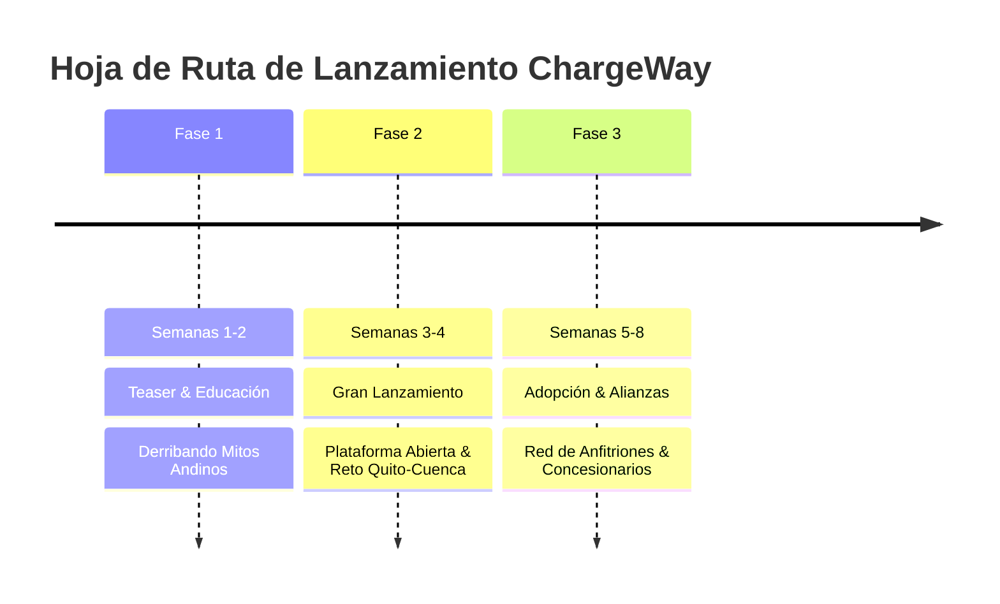

# Guía Estratégica de Campañas de Lanzamiento y Publicidad — ChargeWay Ecuador
*Estrategia Multicanal de Go-to-Market, Copys, Guiones y Plan de Medios // 2026*

---

## 1. Visión General y Objetivos de Lanzamiento

El objetivo de la campaña de lanzamiento es posicionar a **ChargeWay** como la herramienta imprescindible y definitiva para todo propietario de vehículo eléctrico en Ecuador, al tiempo que se recluta activamente a la primera oleada de **anfitriones de recarga (ChargeWay Partners)** a lo largo de las principales carreteras del país.

### KPIs Principales del Lanzamiento (Primeros 90 Días):
- **Conductores Registrados:** 2,500+ propietarios de vehículos eléctricos (más del 45% del parque automotor EV nacional estimado en Ecuador).
- **Rutas Simuladas / Planificadas:** 25,000+ trayectos interprovinciales calculados en la plataforma web y app.
- **Puntos de Carga Activos en Red:** 250+ electrolineras públicas y privadas integradas.
- **Anfitriones Comerciales Nuevos (Parqueaderos/Hoteles):** 60+ comercios habilitados con saldo prepagado.
- **Costo de Adquisición de Usuario (CAC):** < $1.20 USD por conductor verificado.

---

## 2. Segmentación de Audiencias y Buyer Personas

```
┌────────────────────────────────────────────────────────────────────────┐
│                        ECOSISTEMA CHARGEWAY                            │
├──────────────────────────┬─────────────────────────────────────────────┤
│  LADO DEMANDA            │  LADO OFERTA (PARTNERS)                     │
│  • Conductor Particular  │  • Hoteles y Restaurantes en Ruta (E35)     │
│  • Flota Comercial / Taxi│  • Parqueaderos Urbanos y Comerciales       │
└──────────────────────────┴─────────────────────────────────────────────┘
```

### Persona A: Carlos — "El Conductor Pionero EV"
- **Perfil:** 38 años, profesional en Quito/Cumbayá. Compró recientemente un BYD Yuan Pro o Kia EV6.
- **Punto de Dolor Principal:** Ansiedad de autonomía al salir de la ciudad. Pregunta recurrente: *"¿Podré ir a Ibarra o a Baños sin quedarme varado en el páramo si prendo el aire acondicionado?"*
- **Mensaje Clave:** *"ChargeWay no adivina: calcula la altimetría de los Andes, la regeneración en bajada y te dice con qué porcentaje exacto llegas."*

### Persona B: Ing. Patricio — "El Dueño de Hostería / Parqueadero"
- **Perfil:** 52 años, propietario de una hostería turística en Cotopaxi o Baños con estacionamiento propio.
- **Punto de Dolor:** Quiere ingresos extra y atraer turistas de alto poder adquisitivo, pero teme meterse en líos burocráticos con la distribuidora eléctrica.
- **Mensaje Clave:** *"Convierte tu parqueo en un punto de recarga formal. 5 reservas mensuales gratis, cobro por hora de estacionamiento y 100% de cumplimiento legal con ARCONEL."*

### Persona C: Concesionarios Automotrices (BYD, Tesla, Hyundai, Kia)
- **Perfil:** Gerentes de ventas de concesionarios de autos eléctricos.
- **Punto de Dolor:** Muchos prospectos interesados no compran porque dicen: *"En Ecuador no hay dónde cargar fuera de Quito y Guayaquil"*.
- **Mensaje Clave:** *"ChargeWay es la herramienta de cierre de ventas. Demuéstrale a tu cliente en la pantalla que sí puede viajar a la playa o a la sierra con total seguridad."*

---

## 3. Plan de Campaña en Tres Fases



### Fase 1: Semanas 1 y 2 — "El Mito del Páramo" (Campaña Teaser)
- **Concepto:** Confrontar el mayor temor popular: *"Los carros eléctricos no sirven para la geografía de Ecuador"*.
- **Táctica:** Videos virales cortos mostrando autos subiendo a 4,000 metros de altitud y demostrando cuántos kWh se regeneran en la bajada por gravedad.

### Fase 2: Semanas 3 y 4 — "Conquista los Andes" (Gran Lanzamiento)
- **Concepto:** Presentación oficial de la plataforma web y la app móvil.
- **Acción:** Transmisión en vivo de un viaje real Quito ➔ Guayaquil y Quito ➔ Cuenca guiado al 100% por el Copiloto IA de ChargeWay, transmitiendo telemetría en tiempo real.

### Fase 3: Semanas 5 a 8 — "Ecuador Electrificado" (Expansión B2B)
- **Concepto:** Reclutamiento masivo de anfitriones comerciales y distribución física del kit de bienvenida en concesionarios aliados.

---

## 4. Biblioteca de Copys Publicitarios por Canal

### 4.1 Meta Ads (Instagram & Facebook Feed + Reels)

#### Opción 1 — Enfoque Emocional / Libertad (Top of Funnel):
> **Texto del Post:**  
> ¿Te dijeron que con un auto eléctrico solo puedes rodar dentro de la ciudad? ⚡⛰️  
>  
> En Ecuador, las montañas no son un obstáculo: son una fuente de energía. Gracias a la regeneración gravitatoria, en tramos como la bajada de Guayllabamba o el descenso del Cajas tu batería vuelve a cargarse mientras frenas.  
>  
> Con **ChargeWay**, planificas tu viaje en segundos. Nuestro motor físico calcula la altimetría de los Andes, el clima y los más de 200 cargadores del país para que viajes con CERO ansiedad de autonomía.  
>  
> 🚗 Acceso libre y 100% gratuito para conductores.  
> 🔗 **Calcula tu ruta hoy mismo en:** [chargeway.ec](https://chargeway.ec)  
>  
> **Botón CTA:** Probar Planificador Gratis ➔

---

#### Opción 2 — Enfoque Comparativa de Costos (Middle of Funnel):
> **Texto del Post:**  
> ⛽ Tanquear un SUV a gasolina Quito - Manta: **$45.00 USD**  
> ⚡ Recargar tu EV con ChargeWay en la misma ruta: **$8.20 USD**  
>  
> La diferencia no es solo económica: es la tranquilidad de saber exactamente dónde parar 15 minutos a tomar un café mientras tu auto recupera el 45% de carga.  
>  
> Conoce la autonomía real de tu BYD, Kia, Hyundai o Tesla en las carreteras ecuatorianas.  
>  
> **Botón CTA:** Ver Mapa de Cargadores ➔

---

### 4.2 LinkedIn Ads (B2B Anfitriones y Hotelería)
> **Titular:** Convierte los estacionamientos de tu hotel o restaurante en una fuente de ingresos recurrentes.  
> **Texto:**  
> El parque automotor eléctrico en Ecuador crece a doble dígito mensual. Los conductores de vehículos eléctricos planifican sus paradas donde hay un punto de recarga seguro.  
>  
> Con **ChargeWay Partner**, publica tus puntos de parqueo con recarga por horas:  
> ✅ 5 primeras reservas de cada mes libres de comisión ($0 USD).  
> ✅ Sistema de billetera prepagada sin cobros ocultos.  
> ✅ Verificación automática de cumplimiento legal con ARCONEL.  
>  
> Atrae clientes de alto valor mientras almuerzan o se hospedan en tu establecimiento.  
> 🔗 Conoce el modelo de sostenibilidad para anfitriones: [chargeway.ec/partner](https://chargeway.ec/partner)

---

## 5. Guiones para Video Ads, Reels y TikTok

### Guión 1: "El Reto de la Bajada" (30 segundos — Formato 9:16)
- **Segundo 0-3 (Hook visual):** Primer plano al tablero de un auto eléctrico marcando `34% SoC` al coronar el páramo a 3,800 metros de altitud. Conductor mira a cámara preocupado.
  - *Audio (Voz en off):* "¿Te quedarías varado en el páramo si tu batería marca 34%?"
- **Segundo 3-10 (Tensión & Giro):** Conductor enciende el Copiloto IA de ChargeWay en su teléfono montado en el tablero.
  - *Voz Copiloto Andrea:* "Tranquilo Boris. Iniciando descenso hacia Guayllabamba. Recuperarás +4.2% por frenado regenerativo. Llegarás con 38% a tu destino."
- **Segundo 10-22 (Demostración de producto):** Tomas rápidas del mapa nocturno de ChargeWay trazando la ruta neón, curvas de nivel y el paso por la estación rápida Terpel Calderón 60kW.
- **Segundo 22-30 (Cierre y CTA):** El auto llega a su destino con la batería cargada y el conductor sonríe.
  - *Voz en off:* "No adivines tu batería. Planifica con física real. Descarga ChargeWay gratis hoy mismo."
  - *Pantalla final:* Logo ChargeWay animado + `chargeway.ec` + Badges de descarga.

---

### Guión 2: "Dejar de Quemar Dinero" (45 segundos — Formato 9:16)
- **Segundo 0-5:** Persona en gasolinera viendo el contador subir rápidamente a `$40.00... $55.00 USD`. Expresión de frustración.
- **Segundo 5-15:** Corte dinámico al enchufe de carga rápida conectándose a un EV con un clic metálico satisfactorio y halo neón.
- **Segundo 15-30:** Recorrido por el mapa interactivo de ChargeWay mostrando más de 200 cargadores en Quito, Guayaquil, Cuenca, Manta, Baños y Loja.
- **Segundo 30-45:** Cierre institucional: "Ecuador ya está electrificado. Solo necesitabas el mapa correcto. ChargeWay."

---

## 6. Publicidad Exterior (OOH): Vallas en Corredores Estratégicos

Para maximizar el impacto en carretera, se seleccionan 4 ubicaciones de vallas digitales y estáticas en autopistas troncales:

| Ubicación | Corredor Vial | Mensaje en la Valla | Público Impactado |
| :--- | :--- | :--- | :--- |
| **Peaje Machachi (Sur)** | E35 Panamericana Sur | *"¿Rumbo a Latacunga o Baños? Conoce con cuánto % llegas. ChargeWay.ec"* | Conductores que cruzan el nudo de Tiopullo. |
| **Calderón / Guayllabamba** | E35 Panamericana Norte | *"Subir a Otavalo sin miedo. Más de 200 cargadores en tu bolsillo."* | Viajeros de fin de semana hacia Imbabura. |
| **Km 26 Vía a la Costa** | E40 Guayaquil - Santa Elena | *"De Guayaquil a Salinas por $2.50 de recarga. Planifica en ChargeWay."* | Flujo vacacional de alta densidad en la Costa. |
| **Acceso Cajas (Cuenca)** | Vía Cuenca - Molleturo | *"La montaña no frena tu auto eléctrico. Regenera energía con ChargeWay."* | Tráfico interregional Sierra - Costa Sur. |

---

## 7. Estrategia de Alianzas con Concesionarios Automotrices

Para captar a los usuarios en el momento exacto de compra:
1. **El "Kit de Bienvenida ChargeWay":**
   - En alianza con concesionarios oficiales (BYD, Tesla Import, Kia, Hyundai), cada comprador recibe una caja personalizada con:
     - Tarjeta física RFID de acceso directo precargada con su perfil.
     - Llavero técnico ChargeWay con chip NFC.
     - Vinilo decorativo "Ecuador Electrificado".
     - Guía impresa de bolsillo con la red troncal de recarga.
2. **Tablets de Demostración en Showrooms:**
   - Los asesores comerciales utilizan el planificador de ChargeWay en pantallas de 65" para mostrarle al comprador indeciso cómo viajaría a su casa de campo o a la playa sin problemas.
