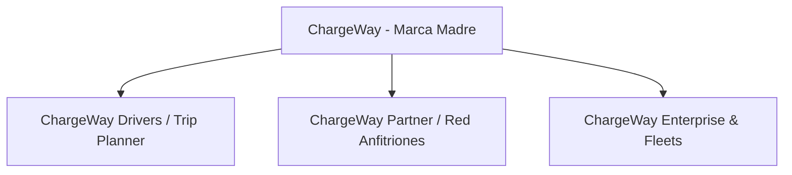

# Manual de Identidad de Marca — ChargeWay Ecuador
*Brand Book & Design System Specification // Versión 2.0*

---

## 1. Plataforma Estratégica y Filosofía de Marca

### 1.1 Manifiesto
En un país donde una ruta de apenas 200 kilómetros puede llevarte desde el nivel del mar hasta más de 4,000 metros de altitud en los páramos andinos, la autonomía de un vehículo eléctrico deja de ser una cifra estática en un catálogo y se convierte en una ecuación viva de física, gravedad y energía.

**ChargeWay** nace para eliminar la ansiedad de autonomía (*range anxiety*) en Ecuador y América Latina. No somos un simple mapa de puntos: somos el copiloto inteligente que combina orografía, aerodinámica, telemetría y la red nacional de carga para que cada conductor viaje con absoluta serenidad. Conquistamos los Andes, la Costa y la Amazonía con tecnología limpia y transparente.

> **Slogan Principal:** *"Drive with Electric Tranquility"* / *"Cero Ansiedad de Autonomia, Libertad Eléctrica Pura"*.

### 1.2 Misión
Proveer a los conductores de vehículos eléctricos y anfitriones de puntos de carga una infraestructura digital confiable, predictiva y accesible que acelere la transición hacia una movilidad sostenible y descarbonizada en Ecuador y la región.

### 1.3 Visión
Convertirnos en la plataforma estándar de enrutamiento inteligente, telemetría y gestión de recarga para vehículos eléctricos en América Latina, integrando vehículos, operadores y usuarios en un ecosistema abierto y transparente.

### 1.4 Valores de Marca
- **Precisión Científica:** Modelamos la realidad física del terreno, no estimaciones superficiales.
- **Tranquilidad y Confianza:** Ofrecemos certidumbre para que el usuario disfrute del viaje.
- **Innovación Audaz:** Combinamos inteligencia artificial, geolocalización y telemetría de vanguardia.
- **Sostenibilidad Activa:** Fomentamos la descarbonización real de nuestras carreteras y ciudades.
- **Apertura Comunitaria:** Apoyamos a pequeños comercios y anfitriones locales con modelos sin fricción.

### 1.5 Arquetipo de Marca
ChargeWay se sitúa en la intersección de **El Sabio (The Sage)** y **El Explorador (The Explorer)**:
- **El Sabio:** Aporta conocimiento técnico profundo, rigor matemático, datos telemétricos exactos y cumplimiento regulatorio estricto.
- **El Explorador:** Invita a salir a la carretera, cruzar cordilleras, descubrir nuevos destinos y atreverse a recorrer el país sin miedo.

---

## 2. Arquitectura de Marca

ChargeWay organiza sus soluciones en una arquitectura monolítica con submarcas funcionales vinculadas:



1. **ChargeWay Drivers (App & Web):**
   - Público: Propietarios y conductores de autos eléctricos particulares.
   - Enfoque: Planificador de ruta gratuito, telemetría en vivo, copiloto IA y tranquilidad de viaje.
2. **ChargeWay Partner (Red de Anfitriones y Electrolineras):**
   - Público: Dueños de parqueaderos, hoteles, restaurantes, gasolineras y centros comerciales.
   - Enfoque: Monetización de espacios con saldo prepagado, reservas por horas, compliance ARCONEL.
3. **ChargeWay Fleet (Empresas y Flotas):**
   - Público: Empresas de logística, flotas corporativas, taxis eléctricos y aseguradoras.
   - Enfoque: Monitoreo de flotas, analítica de degradación de batería y optimización de rutas comerciales.

---

## 3. El Logotipo Oficial y su Anatomía

El logotipo de ChargeWay es una síntesis geométrica de tres elementos conceptuales inseparables:

```
      ▲  Arco Metálico Izquierdo (Acero Titanio) = Solidez, Conectividad y Precisión GPS
     / █ \
    /  █  \ 
   │   ⚡   │  Rayo Central Neón (Cyber Lime / Cyan) = Potencia Eléctrica y Flujo Dinámico
    \  ░  /
     \ █ /  Carretera Winding Highway (E35 Panamericana) = Viaje, Libertad y Destino Seguro
      ▼  Punto de Geolocalización Activo (Halo Neón)
```

### 3.1 Significado de los Componentes
1. **El Pin de Localización:** Representa la infraestructura física: electrolineras, hoteles y parqueaderos georreferenciados en todo el país.
2. **El Rayo Eléctrico Central:** Simboliza la recarga rápida de alta eficiencia (desde 3.7 kW AC hasta 60 kW+ DC) y la energía limpia renovable de Ecuador.
3. **La Carretera Curva Ascendente:** Evoca la legendaria vía Panamericana E35 que cruza los Andes, con líneas punteadas que representan el movimiento y la navegación continua.

### 3.2 Área de Seguridad y Espacio de Resguardo
Para garantizar la máxima legibilidad, el logotipo debe mantenerse siempre libre de textos, bordes o elementos gráficos invasivos.
- **Módulo de Resguardo ($X$):** Se define como la altura del triángulo superior del rayo central.
- El espacio de seguridad perimetral mínimo debe ser de al menos **$1X$** en todos los cuatro costados.

### 3.3 Tamaño Mínimo de Reproducción
- **Digital (Pantallas):**
  - Con logotipo completo (Símbolo + Texto): Ancho mínimo de **140 px**.
  - Solo símbolo / App Icon: Ancho mínimo de **32 × 32 px** (16 × 16 px exclusivamente para favicons simplificados).
- **Impreso (Merchandising y Papelería):**
  - Con logotipo completo: Ancho mínimo de **35 mm**.
  - Solo símbolo: Ancho mínimo de **10 mm**.

---

## 4. Variantes Oficiales del Logotipo

Todos los archivos vectoriales maestros se encuentran en la carpeta [`identidad/logos/`](file:///c:/PERSONAL/IA/ChargeWay/identidad/logos/):

| Archivo Vectorial | Fondo Destinado | Aplicación y Contexto |
| :--- | :--- | :--- |
| **[`logo_principal_color.svg`](file:///c:/PERSONAL/IA/ChargeWay/identidad/logos/logo_principal_color.svg)** | Fondo Oscuro (`#070B12`, `#0F172A`) | **Versión Oficial Primaria.** Cabecera web, pantallas OLED, interfaces HUD, vallas nocturnas. |
| **[`logo_principal_light.svg`](file:///c:/PERSONAL/IA/ChargeWay/identidad/logos/logo_principal_light.svg)** | Fondo Blanco / Claro (`#FFFFFF`, `#F8FAFC`) | Facturas, contratos legales, papelería institucional, fondo blanco web, membretes. |
| **[`logo_simbolo_icono.svg`](file:///c:/PERSONAL/IA/ChargeWay/identidad/logos/logo_simbolo_icono.svg)** | Transparente / Neutro | Isotipo independiente para avatares, fotos de perfil en redes sociales, marcas de agua. |
| **[`logo_badge_app.svg`](file:///c:/PERSONAL/IA/ChargeWay/identidad/logos/logo_badge_app.svg)** | Squircle con bisel | Ícono de aplicación para iOS / Android / PWA, instalador de escritorio y accesos directos. |
| **[`logo_monocromo_blanco.svg`](file:///c:/PERSONAL/IA/ChargeWay/identidad/logos/logo_monocromo_blanco.svg)** | Fondos oscuros / de color sólido | Grabado láser, bordado en ropa técnica oscura, serigrafía a 1 tinta, corte en vinilo para lunas. |
| **[`logo_monocromo_negro.svg`](file:///c:/PERSONAL/IA/ChargeWay/identidad/logos/logo_monocromo_negro.svg)** | Fondos claros / papel | Impresión offset monocromática, sellos secos, sellos de goma, documentos notariales. |
| **[`logo_partner_hosts.svg`](file:///c:/PERSONAL/IA/ChargeWay/identidad/logos/logo_partner_hosts.svg)** | Fondo Oscuro | Submarca para la Red de Anfitriones Comerciales y electrolineras aliadas. |
| **[`favicon.svg`](file:///c:/PERSONAL/IA/ChargeWay/identidad/logos/favicon.svg)** | Pestaña del navegador | Ícono vectorial ultra-optimizado para renderizado nítido a 16px, 32px y 64px. |

---

## 5. Usos Prohibidos e Incorrectos del Logotipo

Para preservar la integridad visual y el posicionamiento premium de ChargeWay, queda terminantemente prohibido:
1. **Deformar o Escalar Desproporcionadamente:** Nunca comprimir ni estirar los ejes horizontal o vertical de forma asimétrica.
2. **Alterar la Paleta Cromática:** No sustituir el azul neón (`#00D2FF`) ni el verde lima (`#00F5A0`) por colores genéricos (ej. rojo, magenta, naranja).
3. **Aplicar Sombras Duras o Filtros Obsoletos:** No utilizar sombras paralelas negras sólidas (`drop-shadow`) con opacidad al 100% o efectos de bisel anticuados. Utilizar únicamente las utilidades de resplandor neón difuso (`glow`) especificadas en este manual.
4. **Colocar sobre Fondos con Ruido Excesivo:** No colocar el logotipo sobre fotografías complejas sin una máscara de contraste o viñeta oscura que asegure legibilidad.
5. **Reconfigurar los Elementos:** No separar el rayo del pin ni cambiar la posición relativa de los textos "Charge" y "Way".

---

## 6. Sistema Cromático Integral

ChargeWay utiliza una paleta cromática inspirada en la energía eléctrica de alta tensión, la luminiscencia digital y el cielo nocturno de la serranía andina:

### 6.1 Colores Primarios

#### 1. Electric Cyan
- **HEX:** `#00D2FF`
- **RGB:** `0, 210, 255`
- **HSL:** `191°, 100%, 50%`
- **CMYK:** `C:72 M:0 Y:0 K:0`
- **Pantone:** `PMS 298 C`
- **Rol:** Color primario de acción, botones primarios, iluminación de rutas activas en mapa, acentos de interfaz y halos neón.

#### 2. Cyber Lime / Energy
- **HEX:** `#00F5A0`
- **RGB:** `0, 245, 160`
- **HSL:** `159°, 100%, 48%`
- **CMYK:** `C:60 M:0 Y:65 K:0`
- **Pantone:** `PMS 802 C (Fluorescent)`
- **Rol:** Batería óptima, potencia de carga, tramos de regeneración gravitatoria en bajada, indicadores de salud energética.

#### 3. Deep Midnight Space
- **HEX:** `#070B12`
- **RGB:** `7, 11, 18`
- **HSL:** `218°, 44%, 5%`
- **CMYK:** `C:85 M:75 Y:60 K:80`
- **Pantone:** `PMS Black 6 C`
- **Rol:** Fondo institucional de la plataforma web, app móvil, paneles HUD y material corporativo.

---

### 6.2 Colores Secundarios y Telemétricos

| Nombre del Color | HEX | RGB | Pantone | Función Telemétrica / Semáforo de Batería |
| :--- | :--- | :--- | :--- | :--- |
| **Partner Emerald** | `#10B981` | `16, 185, 129` | PMS 7723 C | Submarca ChargeWay Partner, ingresos netos de anfitriones, éxito verificado. |
| **Highway Sky** | `#06B6D4` | `6, 182, 212` | PMS 3115 C | Telemetría intermedia, badges de categoría, altimetría en mesetas. |
| **Caution Amber** | `#F59E0B` | `245, 158, 11` | PMS 137 C | Advertencia de batería (SoC < 20%), subidas pronunciadas con alto consumo. |
| **Critical Crimson** | `#EF4444` | `239, 68, 68` | PMS 1788 C | Batería crítica (SoC < 10%), cargador fuera de servicio, fuera de alcance. |
| **Titanium Steel** | `#94A3B8` | `148, 163, 184` | PMS 429 C | Textos secundarios, etiquetas de telemetría, divisores de tarjeta. |
| **Pure White** | `#FFFFFF` | `255, 255, 255` | Blanco Puro | Titulares principales, destellos de luz pura en gráficos. |

---

## 7. Tipografía de Marca

La tipografía de ChargeWay combina la audacia editorial contemporánea con la precisión técnica aeroespacial:

### 7.1 Tipografía Titular / Display: **Syne**
- **Clasificación:** Geométrica contemporánea con carácter arquitectónico.
- **Pesos Oficiales:** `ExtraBold (800)` y `Black (900)`.
- **Uso:** Titulares Hero de landing page, vallas publicitarias, slogans de impacto, portadas de presentación.
- **Interletraje (*Letter Spacing*):** `-0.035em` a `-0.04em` (tracking cerrado para máxima contundencia visual).

### 7.2 Tipografía de Lectura y UI: **Space Grotesk**
- **Clasificación:** Sans-serif técnica de proporción abierta y alta legibilidad en pantallas.
- **Pesos Oficiales:** `Regular (400)`, `Medium (500)`, `SemiBold (600)` y `Bold (700)`.
- **Uso:** Párrafos de texto, nombres de cargadores, modales interactivos, menús de navegación, botones y copys editoriales.
- **Interletraje (*Letter Spacing*):** Normal / `-0.01em`.

### 7.3 Tipografía Telemétrica y HUD: **Space Mono**
- **Clasificación:** Monoespaciada técnica con reminiscencias de instrumentación de cabina y aviónica.
- **Pesos Oficiales:** `Regular (400)` y `Bold (700)`.
- **Uso:** Cifras numéricas de porcentaje de batería (`SoC%`), coordenadas GPS, potencia en kW, altitud en m.s.n.m., tarifas ARCONEL y códigos de tarjeta RFID.
- **Interletraje (*Letter Spacing*):** `+0.1em` a `+0.15em` con `text-transform: uppercase`.

---

## 8. Sistema Gráfico, HUD y Estilo Visual

### 8.1 Efecto Glassmorphism HUD (*Heads-Up Display*)
Las tarjetas y paneles de ChargeWay emulan los paneles de cristal líquido de la cabina de un auto eléctrico de última generación:
- **Fondo:** `rgba(15, 23, 42, 0.82)` con gradiente radial sutil.
- **Desenfoque de Fondo (*Backdrop Blur*):** `blur(20px)` a `blur(24px)`.
- **Borde Perimetral:** `1px solid rgba(255, 255, 255, 0.08)`.
- **Hover Activo:** Borde transita a `rgba(0, 210, 255, 0.35)` con sombra de resplandor `var(--cw-glow-cyan)`.

### 8.2 Balizas y Pulsos de Radar
Para denotar cargadores activos en tiempo real en los mapas, se utiliza una animación de radar concéntrico:
```css
@keyframes radarPulse {
  0% { transform: scale(0.95); opacity: 0.8; }
  50% { transform: scale(1.4); opacity: 0; }
  100% { transform: scale(0.95); opacity: 0; }
}
```

---

## 9. Tono de Voz y Guía de Copywriting

### 9.1 Pilares del Tono de Comunicación
1. **Empoderante y Positivo:** Rompemos los miedos y prejuicios sobre los autos eléctricos. En lugar de decir *"Cuidado: no hay cargadores"*, decimos *"ChargeWay calculó tu parada óptima de 14 min en Calderón para llegar con 38% a tu destino"*.
2. **Técnicamente Impecable pero Accesible:** Explicamos la altimetría andina y la regeneración con claridad cotidiana, sin abrumar con física compleja innecesaria.
3. **Orgullo Local Ecuatoriano:** Hablamos con naturalidad de nuestras rutas (la Panamericana E35, el páramo del Cajas, la bajada de Guayllabamba, la vía al mar en Santa Elena).

### 9.2 Glosario Terminológico Oficial
- **SoC (State of Charge):** Estado de carga de la batería expresado en porcentaje (`%`).
- **Regeneración Gravitatoria:** Energía eléctrica recuperada automáticamente por el motor al descender cuestas andinas.
- **Compliance ARCONEL:** Cumplimiento tarifario automático con las regulaciones de la Agencia de Regulación y Control de Energía y Recursos Naturales No Renovables.
- **Cuota Gratuita (Free Tier):** Las primeras 5 reservas mensuales de cada punto de carga registrado en ChargeWay son 100% gratuitas de comisión.
- **Wallet Prepagado / Host Balance:** Billetera digital mediante la cual los anfitriones recargan saldo para mantener activos sus puntos de parqueo para la comunidad.
- **Tranquility Index:** Semáforo de tranquilidad mental del conductor (Óptimo / Precaución / Crítico).

---

## 10. Checklist de Aprobación de Materiales de Marca

Antes de publicar cualquier pieza web, publicitaria o de merchandising, verificar:
- [ ] ¿Se utiliza el archivo SVG oficial del logotipo sin alteraciones de proporción?
- [ ] ¿El contraste de texto sobre el fondo cumple como mínimo el estándar WCAG AA?
- [ ] ¿Se respetan las tipografías oficiales (`Syne` para títulos, `Space Grotesk` para cuerpo, `Space Mono` para datos)?
- [ ] ¿Los códigos de color coinciden con las especificaciones HEX, CMYK o Pantone del manual?
- [ ] ¿El tono del mensaje transmite tranquilidad, libertad y rigor tecnológico?
